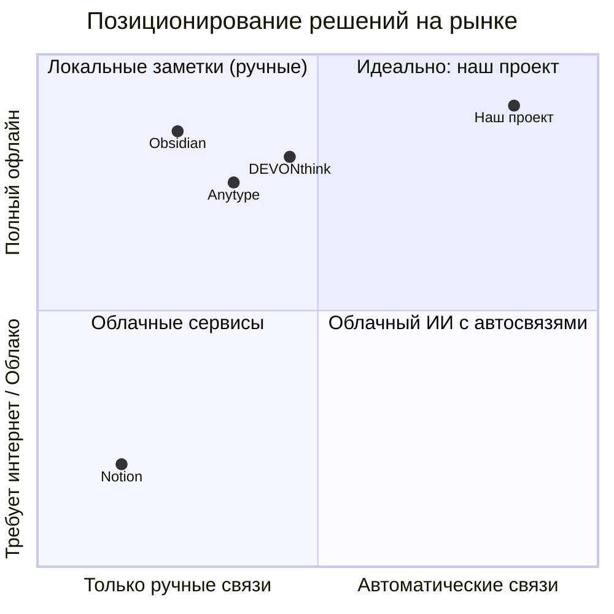

# Анализ решений-аналогов и обоснование преимуществ проекта

## 1. Сравнительный анализ аналогов

Для сравнения взяты распространенные программы для работы с базами знаний и документами: Notion, Obsidian, DEVONthink и Anytype. Оценка проводилась по ключевым критериям из технического задания.

Таблица 1 — Сравнение решений-аналогов и разрабатываемого приложения

| Критерий | Notion | Obsidian | DEVONthink | Anytype | Разрабатываемый проект |
| :--- | :--- | :--- | :--- | :--- | :--- |
| **Работа офлайн** | Нет (только онлайн) | Да (локальные файлы) | Да (локальная база) | Да (локально + P2P) | **Да (полный офлайн)** |
| **Наличие ИИ** | Да (облачный) | Плагины (сторонние API) | Простой поиск по схожести | В разработке (базовый) | **Да (локальные модели)** |
| **Автопостроение связей** | Нет (ссылки вручную) | Вручную (или через теги) | Частично (рекомендации) | Вручную через типы связей | **Да (полный автомат по смыслу)** |
| **Простая установка на средний ПК** | Да (сайт / клиент) | Да (простой установщик) | Только для macOS | Да (установщик) | **Да (один установщик под Windows)** |
| **Легковесность** | Средняя (браузерный движок) | Высокая (быстрый) | Высокая (нативный софт) | Средняя (Electron) | **Высокая (оптимизирован под средний ПК)** |

---

## 2. Слабые стороны аналогов

1. **Notion:** 
   * Без интернета не работает.
   * Все документы уходят на чужие серверы, что не подходит для конфиденциальных данных.
   * Связи между страницами нужно ставить руками.

2. **Obsidian:**
   * Нет встроенного готового ИИ из коробки. Чтобы подключить нейросети, нужно настраивать сторонние плагины и платить за API ключи.
   * Связи между файлами строятся только вручную через wiki-ссылки или теги.

3. **DEVONthink:**
   * Работает исключительно на macOS (нет версии для Windows и Linux).
   * Дорогая лицензия и сложный интерфейс для обычного пользователя.
   * Связи строятся только как рекомендации похожих файлов, без наглядного графа отношений между документами.

4. **Anytype:**
   * Требует сложной настройки структуры (типы объектов, связи, схемы).
   * ИИ-функции пока сырые и требуют ручного распределения данных.

---

## 3. Наглядное сравнение

Рисунок 1 — Карта решений по уровню автономности и автоматизации связей

---

## 4. Конкурентные преимущества проекта

1. **Полная работа без интернета и утечек.** Все файлы, база данных и модели классификации работают локально на компьютере пользователя без отправки текста на внешние серверы.
2. **Связи строятся автоматически.** Пользователю не нужно вручную проставлять ссылки, теги или категории: приложение само находит смысловые зависимости между документами и объединяет их.
3. **Работа на обычном рабочем ПК.** Для запуска программы не нужен мощный сервер с топовыми видеокартами или сложная настройка окружения — программа ставится в один клик и готова к работе.