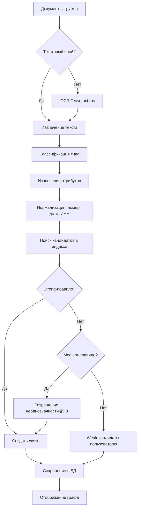

# Правила автоматического определения связей между документами

**Связанные документы:** `docs/supported_documents.md`

---

## 1. Назначение

Документ фиксирует:

1. Справочник типов связей между документами.
2. Формальные правила автоматического определения связей.
3. Матрицу «источник → цель» по типам документов.
4. Схему конвейера связывания.
5. Правила разрешения неоднозначностей и уровни уверенности.
6. Ограничения (что **не** считается связью).

**Базовый принцип (из требований заказчика):** основным сигналом связи является **прямая ссылка по номеру** документа. Остальные правила — вспомогательные и имеют меньшую силу.

---

## 2. Справочник типов связей

| Код | Название | Направление | Описание | Пример |
|:---|:---|:---|:---|:---|
| `references` | Ссылается на | source → target | Общая ссылка без уточнения характера | «в соответствии с приказом № 27» |
| `amends` | Изменяет | source → target | Вносит изменения | «внести изменения в приказ № 9» |
| `repeals` | Отменяет | source → target | Признаёт утратившим силу | «признать утратившим силу приказ № 9» |
| `supplements` | Дополняет | source → target | Дополняет, не изменяя | «дополнить пунктом 5» |
| `implements` | Принят во исполнение | source → target | Издан на основании | «во исполнение постановления № 583» |
| `based_on` | Основан на | source → target | Более слабая форма `implements` | «на основании положения № 25» |
| `attachment` | Приложение к | source → target | Является приложением | «Приложение № 1 к Договору № 45» |
| `addendum` | Доп. соглашение к | source → target | Доп. соглашение к основному | «ДС № 1 к Договору № 45» |
| `supersedes` | Заменяет | source → target | Новый документ вместо старого | «взамен приказа № 9» |
| `version` | Редакция | source → target | Является редакцией | «в редакции приказа № 27» |
| `temporal` | Временнáя связь | ↔ | Созданы в один период / по одному поводу | Документы от одной даты по одному предмету |
| `same_party` | Общий контрагент | ↔ | Совпадает ИНН / наименование стороны | Договор и акт с одним контрагентом |
| `same_subject` | Общий предмет | ↔ | Совпадает предмет (по ключевым словам) | Несколько актов по одному договору |

**Отображение в графе:** `amends`, `repeals`, `implements`, `supersedes` — направленные стрелки с подписью типа; `temporal`, `same_party`, `same_subject` — пунктирные ненаправленные (слабые связи).

---

## 3. Правила автоматического определения связей

Каждое правило имеет:

- **ID** — уникальный идентификатор.
- **Триггер** — что ищем в тексте источника.
- **Условие** — как сопоставляем с целевым документом.
- **Тип связи** — из § 2.
- **Сила** — `strong` (создаём сразу), `medium` (создаём после разрешения неоднозначности), `weak` (только как кандидат пользователю).
- **Приоритет реализации** — P0 / P1 / P2.

### 3.1. Strong-правила (создают связь автоматически)

| ID | Название | Триггер | Условие | Тип | Приоритет |
|:---|:---|:---|:---|:---|:---|
| **R01** | Прямая ссылка по номеру и дате | `(?:№\|N\|номер)\s*(?P<num>[\wА-Яа-я./-]+)\s+от\s+(?P<date>\d{1,2}\.\d{1,2}\.\d{4})` | Точное совпадение `num` и `date` с существующим документом | `references` (или уточняется по лексике: R03/R04/R05) | P0 |
| **R03** | Изменение | `внести\s+изменени[ея]\s+в`, `изложить\s+в\s+новой\s+редакции`, `дополнить` + R01/R02 | Найден target | `amends` | P0 |
| **R04** | Отмена | `признать\s+утратившим\s+силу`, `отменить` + R01/R02 | Найден target | `repeals` | P0 |
| **R05** | Во исполнение | `во\s+исполнение`, `в\s+целях\s+реализации` + R01/R02 | Найден target | `implements` | P0 |
| **R06** | Приложение | `Приложение\s+№\s*\d+\s+к\s+(?P<ref>)`, `является\s+неотъемлемой\s+частью` + R01/R02 | Найден target | `attachment` | P0 |
| **R07** | Доп. соглашение | В шапке: `ДОПОЛНИТЕЛЬНОЕ\s+СОГЛАШЕНИЕ\s+№\s*(?P<num>…)\s+к\s+(?:договору\|контракту)\s+№\s*(?P<pnum>…)\s+от\s+(?P<pdate>…)` | Совпадение `pnum` + `pdate` | `addendum` | P0 |
| **R08** | Акт / Счёт → Договор | В акте/счёте: `Основание[:\s]+договор\s+№\s*(?P<num>…)\s+от\s+(?P<date>…)` или `Договор\s+№\s*(?P<num>…)` | Совпадение с C1 | `references` | P0 |
| **R11** | Редакция | `в\s+редакции` + R01 | Найден target | `version` | P1 |
| **R16** | Замена | `взамен`, `признать\s+утратившим\s+силу\s+…\s+и\s+утвердить` + R01 | Найден target того же типа | `supersedes` | P1 |
| **R17** | Регистрация в Минюсте | `зарегистрирован[оы]?\s+в\s+Минюсте\s+России\s+(?P<date>\d{2}\.\d{2}\.\d{4})\s+№\s*(?P<num>[\w-]+)` | Совпадение `minjust_reg_number` + `minjust_reg_date` | `references` | P1 |

### 3.2. Medium-правила (создают связь после разрешения неоднозначности)

| ID | Название | Триггер | Условие | Тип | Приоритет |
|:---|:---|:---|:---|:---|:---|
| **R02** | Ссылка по номеру без даты | `(?:в\s+соответствии\s+с\|согласно\|на\s+основании)\s+(?:[а-я]+\s+)?(?:№\|N)\s*(?P<num>…)` | Совпадение по `num`; при нескольких кандидатах — разрешение по § 5 | `references` | P0 |
| **R09** | Записка → Регламент / Стандарт / Приказ | `в\s+соответствии\s+с\s+(?P<type>[а-я]+)\s+(?P<num>…)` в E1–E4 | Найден target типа F1–F4 или B1 | `based_on` | P0 |
| **R10** | Серия/префикс номера | В номере источника суффикс `-ДС\d*`, `-СП\d*`, `-А\d*`, `-СЧ` | Базовый номер совпадает с C1 | `addendum` / `attachment` / `references` | P1 |
| **R14** | Нечёткое совпадение номера (OCR-ошибки) | Извлечённый номер не найден точным совпадением | Расстояние Левенштейна ≤ 2; замены `O↔0`, `I↔1`, `З↔3`, `б↔6` | `references` | P1 |
| **R15** | Протокол → Приказ | В приказе: `во\s+исполнение\s+протокола\s+№\s*(?P<num>…)\s+от\s+(?P<date>…)` | Совпадение с B5 | `implements` | P2 |

### 3.3. Weak-правила (только кандидаты, не создаются автоматически)

| ID | Название | Триггер | Условие | Тип | Приоритет |
|:---|:---|:---|:---|:---|:---|
| **R12** | Временнáя связь | Совпадение `date` документа-источника и документа-кандидата | ±3 дня; плюс совпадение `issuer` или `counterparty_inn`; плюс пересечение ключевых слов `subject` | `temporal` | P1 |
| **R13** | Общий контрагент | Совпадение `counterparty_inn` (или `inn`) | Только если документы одного «семейства» (C1–C5, D1–D5, G1–G2) | `same_party` | P1 |
| **R18** | Общий предмет | Пересечение ключевых слов `subject` ≥ 3 значимых термина | Только внутри одного типа | `same_subject` | P2 |

**Поведение weak-правил:** связь **не создаётся** автоматически. Кандидат отображается пользователю в панели «Возможные связи» с кнопками «Подтвердить» / «Отклонить». Подтверждённые связи сохраняются.

### 3.4. Правила, которые НЕ создают связь (антипаттерны)

| Ситуация | Почему не связываем |
|:---|:---|
| Номер без контекста ссылки (например, «в 2024 году» для номера `2024`) | Число не является ссылкой на документ |
| Одноимённые номера разных типов (приказ № 5 и договор № 5) | Требуется совпадение типа |
| Одноимённые номера разных лет (приказ № 5 от 2023 и приказ № 5 от 2024) | Требуется совпадение даты или разрешение по § 5 |
| Упоминание организации в тексте | Упоминание ≠ ссылка на документ |
| Совпадение только ИНН без контекста | Создаёт `same_party` только как weak-кандидат (R13), не автоматическую связь |
| Совпадение даты без других сигналов | Создаёт `temporal` только как weak-кандидат (R12) |

---

## 4. Матрица «источник → цель» по типам документов

Строки — типы источника, столбцы — типы цели. В ячейках — правила, применимые к паре.

| Источник ↓ / Цель → | A (НПА) | B1 (Приказ) | C1 (Договор) | C4 (ДС) | C5 (Спец.) | D1 (Акт) | D3 (Счёт) | F (Регламент) | B5 (Протокол) |
|:---|:---|:---|:---|:---|:---|:---|:---|:---|:---|
| **A1–A5 (НПА)** | R01, R03, R04, R05, R11, R16 | R05 | — | — | — | — | — | — | — |
| **B1 (Приказ)** | R01, R05 | R01, R03, R04, R11, R16 | R02 | — | — | — | — | R09 | R15 |
| **B5 (Протокол)** | — | R05 | — | — | — | — | — | — | — |
| **C1 (Договор)** | — | R05 | R01, R03 | — | R06, R10 | — | — | — | — |
| **C4 (ДС)** | — | — | R07, R10 | R11 | — | — | — | — | — |
| **C5 (Спец.)** | — | — | R06, R10 | — | R11 | — | — | — | — |
| **D1 (Акт)** | — | — | R08, R10 | — | R06 | — | R01 | — | — |
| **D3 (Счёт)** | — | — | R08, R10 | — | — | R01 | R11 | — | — |
| **E1 (Записка)** | R02 | R09 | R02 | — | — | — | — | R09 | — |
| **F (Регламент)** | R05 | R01, R05 | — | — | — | — | — | R03, R11 | — |
| **G1 (Платёжное поручение)** | — | — | R08 | — | — | — | R02 | — | — |
| **H2 (Приказ по л/с)** | — | — | — | — | — | — | — | — | — |

> Слабые правила R12–R13 применимы ко всем парам внутри «семейств» (C1–C5, D1–D5, G1–G2) и показаны пользователю как кандидаты.

---

## 5. Схема конвейера связывания



### 5.1. Порядок применения правил

1. **Strong** (R01, R03, R04, R05, R06, R07, R08, R11, R16, R17) — применяются первыми, создают связи.
2. **Medium** (R02, R09, R10, R14, R15) — применяются после strong; при нескольких кандидатах — § 5.3.
3. **Weak** (R12, R13, R18) — формируют список кандидатов, не создают связей автоматически.

### 5.2. Идемпотентность

- Повторный запуск связывания для документа **не создаёт дублей**.
- Ключ связи: `(source_id, target_id, link_type)`.
- Если связь уже существует — обновляется `confidence` и `evidence`.

### 5.3. Разрешение неоднозначности (несколько кандидатов)

Применяется последовательно, пока не останется один кандидат:

1. **Фильтр по типу документа** — приказ не может быть целью ссылки «договор».
2. **Фильтр по дате** — если в ссылке есть дата, кандидат должен совпадать; если даты нет — окно ±180 дней от даты источника.
3. **Фильтр по органу/организации** — совпадение `issuer` или `inn`.
4. **Приоритет первоисточника** — более ранний документ.
5. **Ручное подтверждение** — если после п. 1–4 осталось ≥ 2 кандидатов, связь не создаётся, кандидаты показываются пользователю.

### 5.4. Уровни уверенности

| Уровень | Диапазон `confidence` | Поведение |
|:---|:---|:---|
| Высокий | 0.90–1.00 | Связь создаётся, отображается сплошной линией |
| Средний | 0.70–0.89 | Связь создаётся, отображается сплошной линией с пометкой «требует проверки» |
| Низкий | 0.50–0.69 | Кандидат, не создаётся автоматически |
| Отброшен | < 0.50 | Не отображается |

`confidence` рассчитывается как произведение:

- `p_class` — уверенность классификатора типа;
- `p_attr` — уверенность извлечения атрибутов (номер, дата);
- `p_rule` — базовая сила правила (strong = 0.95, medium = 0.80, weak = 0.50);
- `p_unambig` — 1.0, если кандидат единственный; 0.7, если после разрешения неоднозначности осталось 2; 0.5 — если ≥ 3.

---

## 6. Хранение и отображение

### 6.1. Модель данных связи

```json
{
  "source_id": "D02",
  "target_id": "D01",
  "link_type": "references",
  "confidence": 0.97,
  "rule_id": "R01",
  "evidence": "…в соответствии с Федеральным законом от 9 февраля 2009 г. № 8-ФЗ…",
  "created_at": "2026-11-08T12:00:00Z",
  "created_by": "auto",
  "status": "confirmed"
}
```

Поле `status`: `confirmed` (создана автоматически), `suggested` (кандидат), `manual` (создана/подтверждена пользователем), `rejected` (отклонена).

### 6.2. Отображение в графе

- **Сплошная линия** — `confirmed`, `confidence ≥ 0.70`.
- **Пунктирная линия** — `suggested`, `confidence 0.50–0.69`.
- **Подпись на ребре** — человекочитаемое название типа связи (`изменяет`, `отменяет`, `приложение к`).
- **Фильтр по типу связи** в интерфейсе.
- **Панель «Возможные связи»** для weak-кандидатов с кнопками «Подтвердить» / «Отклонить».

### 6.3. Ручное редактирование (дополнительная функция)

Согласно требованиям заказчика, редактирование связей — **дополнительная** функция. Минимально:

- удалить автоматически созданную связь (переводит в `rejected`);
- создать связь вручную (переводит в `manual`);
- подтвердить weak-кандидата (переводит в `manual`).

---

## 7. Ограничения

- Связи строятся **только по формальным сигналам** (номер, дата, ИНН, лексические маркеры). «Смысловое» связывание (по смыслу без формальных признаков) на MVP не реализуется.
- Слабое правило `R12` (временнáя связь) **не создаёт связь автоматически** — только кандидат.
- Связи между документами разных языков (русский / английский) не строятся на MVP.
- При низком качестве OCR (`confidence < 0.5` по тексту) документ помечается `low_quality`, связи для него строятся с пониженным `confidence` и не создаются автоматически.

---

## 8. Метрики качества связывания

| Метрика | Целевое значение (MVP) | Как измеряется |
|:---|:---|:---|
| Precision связей | ≥ 0.85 | На `ground_truth_links.csv` |
| Recall связей | ≥ 0.75 | — |
| F1 | ≥ 0.80 | — |
| Доля weak-кандидатов, подтверждённых пользователем | ≥ 0.40 | Логи взаимодействия |

Валидация выполняется скриптом `scripts/evaluate_links.py` против `ground_truth_links.csv` (см. репозиторий).
